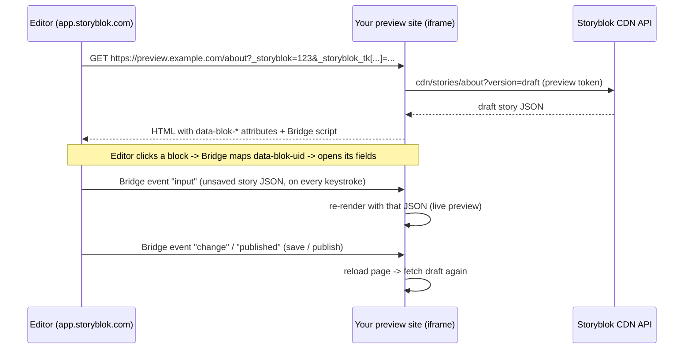

# astor-svelte-test

Storyblok **Visual Editor preview** with **SvelteKit** and **Astro**, written in TypeScript.

This repo holds two minimal reference setups:

| Folder | Framework | Package |
|---|---|---|
| [`sveltekit/`](./sveltekit) | SvelteKit 2 + Svelte 5 | `@storyblok/svelte` |
| [`astro/`](./astro) | Astro | `@storyblok/astro` |

> These are reference files, not complete scaffolded apps: no `package.json`, no lockfile, never built.
> Copy them into a project created with `npx sv create` or `npm create astro@latest`.
> Storyblok SDK APIs change between major versions, so check the imports against the installed version
> (see [Caveats](#caveats)).

---

## Contents

1. [How the Visual Editor preview works (any framework)](#1-how-the-visual-editor-preview-works-any-framework)
2. [SvelteKit walkthrough](#2-sveltekit-walkthrough)
3. [Astro walkthrough](#3-astro-walkthrough)
4. [SvelteKit vs. Astro](#4-sveltekit-vs-astro)
5. [Setup: Storyblok space, env, local HTTPS, deployment](#5-setup)
6. [Security](#6-security)
7. [Rough effort estimate](#7-rough-effort-estimate)
8. [Caveats](#caveats)

---

## 1. How the Visual Editor preview works (any framework)

The Storyblok Visual Editor doesn't render anything itself. It loads **your website** in an iframe and
talks to it through a small script, the **Storyblok Bridge**.



The five building blocks:

1. **Preview URL.** In Storyblok under *Settings → Visual Editor* you set a base URL, e.g.
   `https://preview.example.com/`. Storyblok opens `base URL + story full_slug` and appends query
   parameters:
   - `_storyblok` (story ID)
   - `_storyblok_tk[space_id]`, `_storyblok_tk[timestamp]`, `_storyblok_tk[token]` (signature, see [Security](#6-security))
   - `_storyblok_version`, `_storyblok_lang`, `_storyblok_release`
2. **Draft content.** The preview site fetches from the Content Delivery API with a **preview token** and
   `version: 'draft'`, so editors see unpublished changes. Production uses a **public token** and
   `version: 'published'`.
3. **The Bridge script** (`storyblok-v2-latest.js`, injected by the SDK when `bridge: true`). It
   - highlights blocks on hover and opens a block's fields when it's clicked
   - sends an `input` event with the full unsaved story JSON while the editor types
   - sends `change` / `published` events on save / publish. The SDKs reload the page on these by default.
4. **Editable markers.** `storyblokEditable(blok)` adds `data-blok-c` and `data-blok-uid` attributes
   to a component's root element. Without them the preview still shows content, but clicking a block
   doesn't open it in the editor. **Every block component needs this.**
5. **Rendering on request (SSR) and HTTPS.**
   - The editor only embeds `https://` URLs, local development included.
   - Draft content changes constantly, so a statically pre-built page would show outdated content.
     The preview must be rendered when it's requested.

The frameworks differ mainly in **live updates while typing**:

- **SvelteKit** hydrates on the client, so it can swap in the new JSON and re-render in the browser.
- **Astro** ships no client runtime by default. It either reloads on save, or uses `livePreview`, where
  the server re-renders the page on each input.

---

## 2. SvelteKit walkthrough

```
sveltekit/
├── .env.example
├── vite.config.ts
└── src/
    ├── lib/
    │   ├── storyblok.ts               # SDK init + isPreview flag
    │   └── components/Page.svelte     # example block component
    └── routes/
        ├── +layout.ts                 # runs init once, hands the API client to pages
        └── [...slug]/
            ├── +page.ts               # loads the story (draft or published)
            └── +page.svelte           # renders it + connects the Bridge
```

### `src/lib/storyblok.ts`: initialisation

```ts
export const isPreview = PUBLIC_STORYBLOK_PREVIEW === 'true';

storyblokInit({
  accessToken: PUBLIC_STORYBLOK_TOKEN,
  use: [apiPlugin],          // adds the REST client (storyblokApi.get(...))
  bridge: isPreview,         // load the Bridge script only in the preview deployment
  apiOptions: { region: 'eu' },
  components: { page: Page } // Storyblok component name -> Svelte component
});
```

- **One codebase, two deployments.** `PUBLIC_STORYBLOK_PREVIEW` decides whether a deployment is the
  preview (`true`, preview token, draft content, Bridge) or production (`false`, public token,
  published content, no Bridge).
- **`components`** is the registry `StoryblokComponent` uses to resolve a blok's `component` field
  (e.g. `"page"`, `"teaser"`) to a Svelte component. Every new block type gets registered here.
- **`region`** must match the space's region (`eu`, `us`, `ap`, `ca`, `cn`).

### `src/routes/+layout.ts`: run init once

```ts
export const load: LayoutLoad = async () => ({ storyblokApi: await initStoryblok() });
```

This is a **universal** load function (`.ts`, not `.server.ts`), so it runs on the server for the
first request and in the browser afterwards. It can return the non-serialisable API client, and every
page gets it through `await parent()`.

### `src/routes/[...slug]/+page.ts`: load the story

```ts
const { data } = await storyblokApi.get(`cdn/stories/${params.slug || 'home'}`, {
  version: isPreview ? 'draft' : 'published'
});
```

- **`[...slug]`** is a catch-all route, so `/`, `/about` and `/blog/post-1` all map to Storyblok's
  `full_slug`. The root `/` maps to the story `home`.
- **`version`** comes from the deployment flag.
- **Errors:** a status from Storyblok (e.g. 404) becomes a SvelteKit `error()`, so missing stories
  render the error page.

### `src/routes/[...slug]/+page.svelte`: render and live update

```svelte
let { data }: PageProps = $props();
let story = $derived(data.story);

onMount(() => {
  if (isPreview) useStoryblokBridge(story.id, (s) => (story = s));
});
```

- **`useStoryblokBridge(id, callback)`** subscribes to the Bridge. On every `input` event the callback
  receives the unsaved story JSON. Assigning it to `story` makes Svelte re-render immediately, so the
  editor sees changes **while typing, without a reload**. On save/publish the Bridge reloads the page.
- **Writable `$derived`** (Svelte ≥ 5.25): `story` follows `data.story` when the user navigates, but
  can be overwritten by the Bridge in between. A plain `$state(data.story)` would freeze on the first
  story and break client-side navigation.
- **`onMount`** runs only in the browser, where the Bridge lives.

### `src/lib/components/Page.svelte`: a block component

```svelte
<main use:storyblokEditable={blok}>
  {#each blok.body ?? [] as child (child._uid)}
    <StoryblokComponent blok={child} />
  {/each}
</main>
```

- **`use:storyblokEditable`** is a Svelte action that adds the `data-blok-*` attributes for
  click-to-edit.
- **`StoryblokComponent`** renders nested bloks recursively through the registry. Every block
  component follows this pattern.

### `vite.config.ts`: HTTPS locally

`@vitejs/plugin-basic-ssl` serves the dev server at `https://localhost:5173` with a self-signed
certificate. Open that URL once in the browser and accept the certificate, otherwise the editor iframe
stays blank.

### SvelteKit deployment note

The preview deployment must render on request (`adapter-node`, `adapter-vercel`, `adapter-netlify`, …).
If production uses `adapter-static` or `prerender = true`, deploy the preview separately with an SSR
adapter, or set `export const prerender = false` for the preview build.

---

## 3. Astro walkthrough

```
astro/
├── .env.example
├── astro.config.ts           # integration + static/server switch
└── src/
    ├── pages/[...slug].astro # loads + renders the story
    └── storyblok/Page.astro  # example block component
```

### `astro.config.ts`: one config, two build modes

```ts
const isPreview = env.STORYBLOK_PREVIEW === 'true';

export default defineConfig({
  output: isPreview ? 'server' : 'static',
  adapter: isPreview ? node({ mode: 'standalone' }) : undefined,
  integrations: [storyblok({
    accessToken: env.STORYBLOK_TOKEN,
    bridge: isPreview,
    livePreview: isPreview,
    apiOptions: { region: 'eu' },
    components: { page: 'storyblok/Page' }
  })],
  vite: { plugins: [basicSsl()] }
});
```

Astro builds **static HTML by default**. That's ideal for production but useless for previewing drafts,
so the same repo builds in one of two modes:

| | Production | Preview |
|---|---|---|
| `output` | `static` | `server` (SSR) |
| Adapter | none (plain files on a CDN) | `@astrojs/node` (or vercel/netlify) |
| Token | public | preview |
| Content | `published` | `draft` |
| Bridge / livePreview | off | on |
| Content update | Storyblok **publish webhook** triggers a rebuild | live, on every request |

- **`env` comes from `loadEnv`** because `astro.config.ts` runs before Astro's own env handling.
- **`components`** maps Storyblok component names to **file paths relative to `src/`** (not imports, as
  in Svelte).
- **`bridge`** injects the Bridge script into every page. With `livePreview` off, the Bridge reloads
  the page on save, which gives working click-to-edit but no updates while typing.
- **`livePreview`** turns on live editing: on every `input` event the injected client script sends the
  unsaved story to the server, the server re-renders the page with it, and the client swaps in the new
  HTML. This costs **one server render per keystroke**, which is fine for editors but is the reason it
  only runs in the preview deployment.

### `src/pages/[...slug].astro`: load and render

```astro
export async function getStaticPaths() { /* cdn/links -> one page per story */ }

let story = (isPreview ? await getLiveStory(Astro) : null) as ISbStoryData | null;
if (!story) {
  const { data } = await useStoryblokApi().get(`cdn/stories/${slug}`, {
    version: isPreview ? 'draft' : 'published'
  });
  story = data.story;
}
```

- **`getStaticPaths`** (static production build only, ignored in server mode) fetches all links from
  `cdn/links` and generates one HTML file per story. Folders are skipped and `home` becomes `/`.
  It reads one page of up to 1000 links. Larger spaces need pagination.
- **`getLiveStory(Astro)`** returns the unsaved story while a live preview re-render is running, and
  `null` otherwise. In that case the page fetches normally: draft in preview, published in production.
- **`noindex`** keeps search engines from indexing the preview deployment.

### `src/storyblok/Page.astro`: a block component

```astro
<main {...storyblokEditable(blok)}>
  {blok.body?.map((child) => <StoryblokComponent blok={child} />)}
</main>
```

This is the same idea as Svelte, but `storyblokEditable` returns an object of attributes that is
spread onto the element.

---

## 4. SvelteKit vs. Astro

| | SvelteKit | Astro |
|---|---|---|
| Rendering default | SSR + hydration | static HTML, zero JS |
| Live update while typing | built in, on the client (`useStoryblokBridge`) | `livePreview`, re-rendered on the server per input |
| Without live update | — | reload on save |
| Separate preview deployment | only if production is prerendered | practically always (static vs. server) |
| Component registry | imports | file paths |
| Click-to-edit | `use:storyblokEditable` | `{...storyblokEditable(blok)}` |
| Extra infrastructure | none if SSR already runs | SSR host for preview + publish webhook for prod rebuilds |

---

## 5. Setup

### Storyblok space

1. *Settings → Access Tokens*: create a **Preview** token (draft access) and a **Public** token.
2. *Settings → Visual Editor*: set the preview URL.
   - Local: `https://localhost:5173/` (SvelteKit) or `https://localhost:4321/` (Astro)
   - Deployed: `https://preview.example.com/`
3. Optional, Astro production: *Settings → Webhooks → Story published* → your host's build hook, so
   publishing triggers a rebuild.
4. Check that the stories' `full_slug` match the routes (`home` → `/`).

### Environment

Copy `.env.example` to `.env`:

| Deployment | SvelteKit | Astro |
|---|---|---|
| Preview | `PUBLIC_STORYBLOK_TOKEN=<preview>`<br>`PUBLIC_STORYBLOK_PREVIEW=true` | `STORYBLOK_TOKEN=<preview>`<br>`STORYBLOK_PREVIEW=true` |
| Production | `PUBLIC_STORYBLOK_TOKEN=<public>`<br>`PUBLIC_STORYBLOK_PREVIEW=false` | `STORYBLOK_TOKEN=<public>`<br>`STORYBLOK_PREVIEW=false` |

### Dependencies

```bash
# SvelteKit
npm i @storyblok/svelte
npm i -D @vitejs/plugin-basic-ssl

# Astro
npm i @storyblok/astro @astrojs/node
npm i -D @vitejs/plugin-basic-ssl
```

### Run locally

```bash
npm run dev   # open https://localhost:<port> once, accept the certificate
```

Then open a story in Storyblok. The page should load in the iframe, blocks should highlight on hover,
and typing should update the page live.

---

## 6. Security

- **The preview token can read drafts.**
  - In SvelteKit, `PUBLIC_*` env vars end up in the client bundle.
  - Use the preview token **only** in the preview deployment, and put that deployment behind access
    protection (basic auth, IP allowlist, SSO) plus `noindex`.
  - Production only ever gets the public token.
- **Optional: verify the request comes from the editor.** Storyblok signs the iframe URL:
  `_storyblok_tk[token] === sha1(`${space_id}:${previewToken}:${timestamp}`)`. A server-side check of
  that value (and a reasonably recent `timestamp`) means drafts are only served inside the Visual
  Editor. It isn't implemented here, so add it if the preview can't be access-protected.
- **Allow framing.** If the host sets `X-Frame-Options: DENY` or a strict CSP `frame-ancestors`, allow
  `https://app.storyblok.com` on the preview deployment, otherwise the iframe stays blank.

---

## 7. Rough effort estimate

PT = person-days. A very rough estimate:

| Task | SvelteKit | Astro |
|---|---|---|
| SDK setup, draft/published switch, Bridge | 0.5–1 PT | 0.5–1 PT |
| `storyblokEditable` on all block components (depends on how many there are) | 0.5–2 PT | 0.5–2 PT |
| Preview environment (SSR deploy, HTTPS, env, Storyblok config, access protection) | 0.5 PT if SSR already runs | 1–2 PT (separate SSR build/adapter) |
| Live update while typing | included | +0.5–1 PT (`livePreview`, testing) |
| **Total** | **~2–3 PT** | **~3–5 PT** |

These factors make it take longer:
- many block components
- content from sources other than Storyblok, which won't update live
- multiple languages
- hosting without simple SSR support

---

## Caveats

- **Not built or tested.** These are reference files. Scaffold a real project and copy them in.
- **Check SDK versions.** These APIs have moved between major releases of the Storyblok SDKs:
  - `getLiveStory`
  - the `@storyblok/astro/StoryblokComponent.astro` import path
  - the `livePreview` option
  - the `useStoryblokApi()` signature

  Compare against the README of the version you install.
- **Writable `$derived`** in `+page.svelte` needs Svelte ≥ 5.25.
- **`getStaticPaths`** reads at most 1000 links. Add pagination for larger spaces.
